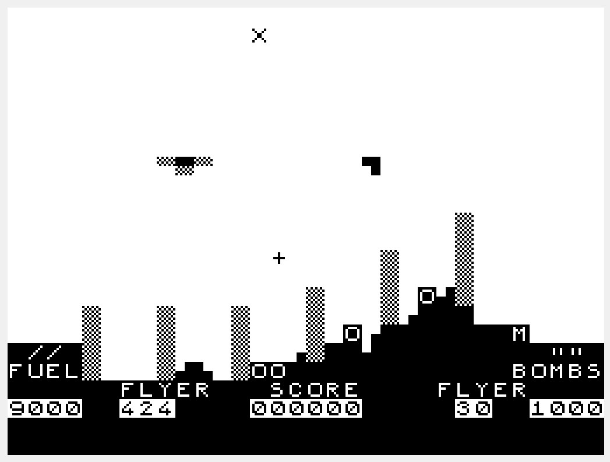
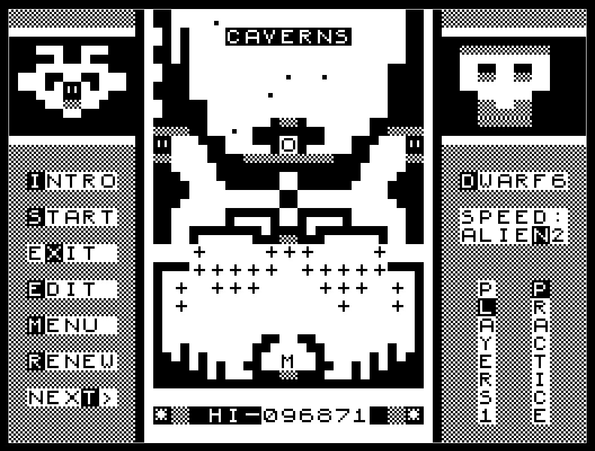

Repo for Delphi based ZX81 remakes. Converted to Lazarus and Free PASCAL.

- Fungaloids for Windows v1.2
- Fungaloids for Linux v1.3

- Caverns for Windows v1.5
- Caverns for Linux v1.6

Executables in the zip folders : lib\x86_64-win64

No Ai : Caverns v1.5, Fungaloids v1.2.

Ai fixes in Caverns v1.6, Fungaloids v1.3 for the Linux port.
